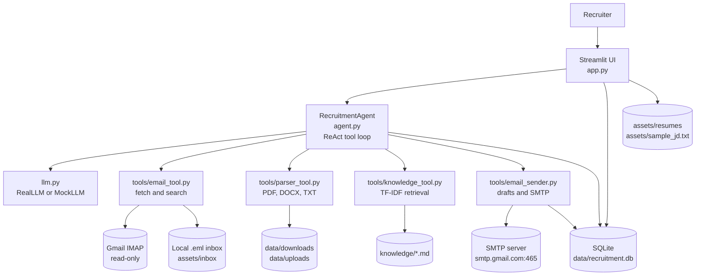

# AI Recruitment Assistant

## A Semester Project Report

**Course:** Artificial Intelligence
**Semester:** 5th
**Institution:** University of the Punjab
**Project type:** Agentic AI application with a Streamlit interface
**Date:** November 2026

---

## 1. Abstract

Recruitment screening is repetitive work. A single job posting can produce dozens of applications, each with a different resume format, and every applicant has to be read, compared against the same requirements, and recorded consistently. Small teams often do this by hand, which costs time and produces uneven decisions.

This project presents an AI Recruitment Assistant that automates the repetitive parts of early-stage screening while keeping the recruiter in control. The system is built around an intelligent agent that uses a large language model to choose tools and act on their results. It reads application email over IMAP or from a local demo inbox, extracts text from PDF and DOCX resumes, retrieves the company hiring rubric from a small knowledge base using TF-IDF cosine similarity, scores each candidate, stores the result in SQLite, and ranks the shortlist.

The assistant is general-purpose within its domain. It can also answer ordinary inbox questions, explain rankings, and send email to candidates. Outbound mail follows a draft-first protocol: the agent writes the message, shows the exact text, and sends only after the user confirms. A code-level confirmation guard enforces this rule even if the language model tries to send early. The result is a working system that demonstrates agentic reasoning, tool calling, retrieval-augmented generation, persistent memory, and human-in-the-loop safety in one application. The implementation is pure Python, runs without an API key in an offline mock mode, and is covered by a 20-test suite.

## 2. Introduction

### 2.1 Problem statement

Hiring teams receive applications as email attachments. The work that follows is mostly mechanical but not simple. Someone has to open each message, check whether a resume is attached, extract the text, compare the candidate against the job description and the company rubric, assign scores, record a justification, and produce a ranked list. Doing this manually is slow. Doing it inconsistently is worse, because two recruiters may weight the same evidence differently.

Automation helps only if it is transparent. A black-box score is difficult to defend to a candidate, a hiring manager, or an auditor. The system therefore needs to show its reasoning, cite evidence from the resume, apply the same rubric to everyone, and avoid changing the inbox or sending mail without permission.

### 2.2 Motivation

The project explores a practical question: can a language model act as a competent assistant rather than a text generator? Modern models can call functions, inspect the result, and decide what to do next. That capability maps well onto recruitment, where the steps are clear but the order depends on what each email contains. Some messages have resumes, some do not, some attachments fail to parse, and some candidates need a closer look. A fixed pipeline struggles with this variation. An agent can adapt.

A second motivation is safety. Sending email is an irreversible action. An assistant that can send mail must not do so because it inferred an instruction. It should prepare the message, present it, and wait for a clear human confirmation. This project treats that requirement as a design constraint, not a prompt suggestion.

### 2.3 Scope

The delivered system supports on-demand screening of a Gmail inbox or a local folder of `.eml` files, resume parsing, rubric-based evaluation, persistence, ranking, read-only inbox search, and confirmed outbound email. It does not implement scheduling, background polling, outbound attachments, HTML templates, or reply threading. These exclusions are deliberate and are discussed in Section 12.

## 3. Objectives

The project has the following objectives:

1. Build an intelligent agent that plans and executes a recruitment workflow through tool calls rather than a hard-coded sequence.
2. Read applications from a real Gmail inbox over IMAP and from a credential-free local inbox for demonstrations.
3. Extract text from PDF, DOCX, TXT, and Markdown resumes.
4. Apply a company hiring rubric consistently using retrieval-augmented generation and bounded scoring.
5. Store candidates, processed email identifiers, conversation history, job descriptions, and email drafts in SQLite.
6. Produce a ranked, explainable shortlist with strengths, weaknesses, missing skills, and a recommendation.
7. Support general, read-only inbox questions without triggering the screening workflow or marking mail as read.
8. Allow the recruiter to send email to a candidate or a group through chat, using a draft-first flow with an explicit confirmation.
9. Enforce the confirmation rule in code so that the model cannot bypass it.
10. Provide a usable Streamlit interface with a live tool trace, leaderboard, charts, CSV export, and knowledge viewer.
11. Run fully offline for demonstrations and automated tests.
12. Verify the main behaviours with an automated test suite.

## 4. Background and Concepts

### 4.1 Intelligent agents

An intelligent agent perceives its environment and takes actions to achieve a goal. Russell and Norvig describe agents by their degree of autonomy, reactivity, and goal direction. A simple reflex agent follows fixed rules. A goal-based agent reasons about future states. This project implements a goal-based, tool-using agent. Its environment is the combination of the chat request, the inbox, the filesystem, the knowledge base, and the database. Its actions are tool calls. Its goals arrive in natural language.

The agent is not autonomous in the sense of running continuously. It acts only when the user submits a message. This is a deliberate design choice: an email assistant that acts on its own would be difficult to supervise and would violate the project requirement that all email work is on demand.

### 4.2 The ReAct loop

ReAct, introduced by Yao et al., interleaves reasoning and acting. The model thinks about what to do, performs an action, observes the result, and repeats. The original formulation uses textual reasoning traces. This project uses the same control pattern through native tool calling:

1. The model receives the conversation and a list of available tools.
2. It returns either a final answer or one or more tool calls.
3. The application executes each tool and appends the result as an observation.
4. The model receives the updated conversation and decides again.
5. The loop ends when the model answers without a tool call, when a duplicate-call guard fires, or when the step limit is reached.

The loop is implemented in `RecruitmentAgent.run()` in `agent.py`. The maximum number of iterations is set by `MAX_AGENT_STEPS` in `config.py`, which is 80. A step limit prevents runaway loops and unbounded API cost.

### 4.3 LLM tool calling and function calling

Tool calling lets a model request a structured function invocation instead of only producing text. Each tool is declared with a name, a description, and a JSON Schema for its parameters. The model returns a tool call with a name and a JSON argument object. The host application validates and executes it, then returns the result in a message with the matching tool call identifier.

The project declares twelve tools in `agent.py`: `fetch_new_applications`, `search_inbox`, `parse_resume`, `search_knowledge`, `evaluate_candidate`, `save_candidate`, `skip_email`, `get_leaderboard`, `get_candidate_details`, `draft_email`, `send_draft`, and `send_batch`. The model is told to call tools when the request requires action and to answer directly for general questions. The host maps each tool name to a private `_tool_*` method, catches exceptions, and returns error dictionaries as observations so that the model can adapt instead of crashing.

### 4.4 Retrieval-augmented generation with TF-IDF

Retrieval-augmented generation combines a retrieval step with a generative model. Instead of relying only on the model's internal knowledge, the system retrieves relevant documents and places them in the prompt. This grounds the output in local policy.

The knowledge base in this project consists of two Markdown files: `knowledge/hiring_rubric.md` and `knowledge/interview_guidelines.md`. `tools/knowledge_tool.py` splits each file on Markdown headings, tokenizes the chunks, removes stopwords and single-character tokens, and builds a TF-IDF index. At query time it builds a TF-IDF vector for the query, computes cosine similarity against every chunk, and returns the top `k` chunks with positive similarity. The index is cached with `lru_cache`, and `reload_index()` clears the cache when the knowledge viewer reloads the files.

TF-IDF is a lexical method. It rewards terms that are frequent in a chunk but rare across the corpus. It is small, deterministic, dependency-free, and adequate for a knowledge base of this size. Its limitation is that it does not understand synonyms or paraphrases. That trade-off is discussed in Section 12.

### 4.5 IMAP and SMTP

Email uses different protocols for different directions. IMAP is used to read mail from a mailbox. SMTP is used to send mail. This project keeps the two paths separate.

Inbound reading is implemented in `tools/email_tool.py` with the standard library `imaplib`. The connection uses `IMAP4_SSL`, logs in with the configured address and app password, and selects the inbox in read-only mode. Application checks search for `UNSEEN` messages, fetch them, and save supported attachments. General inbox search builds a read-only search expression from optional `UNSEEN`, `SINCE`, and `TEXT` criteria. Because the mailbox is selected read-only, the system does not change message flags.

Outbound sending is implemented in `tools/email_sender.py` with `smtplib` and `email.message.EmailMessage`. It opens `SMTP_SSL` on the configured server and port, logs in, and sends a plain-text message. Gmail uses `imap.gmail.com` and `smtp.gmail.com` on port 465 for SSL. Gmail requires an app password when two-step verification is enabled. The app password is read from `.env` and is never collected by the interface.

### 4.6 Human-in-the-loop safety

Human-in-the-loop design places a human decision at a critical point in an automated workflow. For sending email, the critical point is the transition from preparation to transmission. The system enforces a draft-first protocol:

1. The agent creates a draft and stores it in the database with status `pending`.
2. The agent shows the exact recipients, subject, and body, then asks for confirmation.
3. The agent is instructed not to send in the same turn as drafting.
4. When the user replies, the agent may call a send tool only if the current message matches an explicit confirmation pattern.
5. If it calls a send tool without confirmation, `_tool_send_draft` and `_tool_send_batch` return an error and send nothing.

This guard is implemented in code in `agent.py` through `CONFIRM_RE` and the instance flag `self._send_confirmed`. Prompt instructions alone would be unreliable. The code guard makes the rule enforceable regardless of model behaviour.

## 5. System Design

### 5.1 Design overview

The system follows a layered design:

- **Presentation layer:** a Streamlit application in `app.py`.
- **Agent layer:** `RecruitmentAgent` in `agent.py`, which owns the loop and the tool dispatch.
- **Model layer:** `RealLLM` or `MockLLM` behind a common `chat()` interface in `llm.py`.
- **Tool layer:** five modules under `tools/` for email reading, email sending, parsing, retrieval, and persistence.
- **Configuration layer:** `config.py`, which loads `.env` and defines filesystem paths.
- **Storage layer:** SQLite at `data/recruitment.db`, plus files under `data/downloads` and `data/uploads`.

The presentation layer never talks to IMAP, SMTP, or SQLite directly for agent work. It constructs an agent and calls `run(goal)`. The agent is the only component that decides which tool to use. This separation keeps the UI thin and makes the behavioural logic testable without a browser.

### 5.2 Inputs

The system accepts:

- A natural-language chat message, such as "process new applications", "what emails came in today?", or "email this candidate".
- A job title and job description from the sidebar.
- An inbox source selection: local demo inbox or Gmail.
- An optional application-only filter and a per-check email limit.
- Uploaded resumes in PDF, DOCX, or TXT format.
- Configuration from `.env`: LLM credentials, email credentials, SMTP settings, mock-mode flag, and database path.

### 5.3 Outputs

The system produces:

- A conversational answer from the agent.
- A structured tool trace, rendered as expandable steps in the UI.
- Persistent rows in the `candidates`, `processed_emails`, `chat_memory`, `jobs`, and `drafts` tables.
- A ranked leaderboard with total and component scores, justifications, strengths, weaknesses, missing skills, and recommendations.
- A stacked bar chart and a CSV export of the shortlist.
- Sent email through SMTP, after confirmation, with a per-draft result.

### 5.4 On-demand design

Every email operation is triggered by a user action. There is no background thread, scheduler, cron job, or polling loop. Application checks run when the user presses **Process new applications** or when a chat message asks for one. General inbox searches run only when the user asks a mail question. Sending happens only after a draft and an explicit confirmation.

This choice reduces operational risk. A recruiter can predict when the inbox will be read and when mail will leave the system. It also keeps the project within the scope of a course demonstration, where a long-running worker would add complexity without adding educational value.

## 6. Architecture

The diagram below shows the main components and the external boundaries. The Streamlit UI drives the agent. The agent calls the language model and the tool modules. SQLite stores state. IMAP is read-only. SMTP is write-only for outbound mail.



Three boundaries matter:

1. **Model boundary.** `llm.py` hides provider details. The agent sees a single `chat(messages, tools=None, json_mode=False)` method. Either implementation returns a normalized assistant message with optional `tool_calls`.
2. **Mail boundary.** `email_tool.py` owns inbound reading. `email_sender.py` owns outbound sending. Neither module performs the other's job.
3. **State boundary.** SQLite is the durable store. The Streamlit process is rebuilt on each interaction, so drafts, candidates, and conversation memory cannot live only in memory.

## 7. Component-by-Component Explanation

### 7.1 `app.py`

`app.py` is the Streamlit entry point and the presentation layer. It configures the page, injects a light theme, initializes the database, builds the sidebar, constructs a `RecruitmentAgent`, and renders three tabs.

Key responsibilities:

- **Sidebar configuration.** The user selects the LLM status display, edits the job title and description, chooses the inbox source, enables the application-only filter, sets the email limit, uploads resumes, tests the Gmail connection, and resets candidates and memory.
- **Prompt expansion.** `expand_action(prompt, job_title)` converts short replies such as "check", "yes", or "go ahead" into a full screening request. This keeps the chat natural while giving the agent an unambiguous goal.
- **Agent invocation.** The chat input calls `agent.run(prompt, on_step=live)`. The `live` callback writes a human-readable progress line for each tool step through the `PROGRESS` mapping.
- **Trace rendering.** `render_trace(trace)` turns each tool call into an expander containing the arguments and the result.
- **Leaderboard.** The second tab reads ranked candidates, shows metrics, a dataframe, a stacked bar chart, per-candidate detail expanders, and a CSV download.
- **Knowledge viewer.** The third tab displays every Markdown file in `knowledge/` and calls `reload_index()` so edits are picked up.
- **Pending drafts.** A small expander lists drafts with status `pending` so the user can see what is waiting for confirmation.
- **Error handling.** If the model call fails, the UI shows a friendly message that points at `LLM_BASE_URL`, `LLM_API_KEY`, and `LLM_MODEL`.

Dependencies: `streamlit`, `pandas`, `config`, `RecruitmentAgent`, `get_llm`, `tools.database`, `check_imap_connection`, and `reload_index`.

### 7.2 `agent.py`

`agent.py` contains the core intelligence. It defines the system prompt, the tool schemas, the confirmation and action regular expressions, the observation serializer, and the `RecruitmentAgent` class.

Key elements:

- **`SYSTEM_PROMPT`.** Sets the assistant's voice and routing rules. It tells the model when to answer directly, when to use `search_inbox`, when to run the application workflow, and when to use candidate tools. It also defines the emailing protocol: draft first, show the text, confirm, then send.
- **`TOOLS`.** A list of twelve JSON Schema tool declarations passed to the model on every step.
- **`WEIGHTS`.** Maps the three sub-scores to their maxima: skills 50, experience 35, education 15.
- **`ACTION_RE`.** Detects action-oriented requests such as "process", "screen", "fetch", "review", "scan", or "check". If the model replies without a tool on such a request, the loop nudges it once to act.
- **`CONFIRM_RE`.** Matches explicit confirmations at the start of the user message, including "yes", "ok", "go ahead", "send", "send it", "send them", "send now", "please send", "confirm", and "go for it".
- **`tool_observation(result, limit=30000)`.** Serializes a tool result as JSON. If the payload exceeds the limit, it shrinks long strings and long lists, then falls back to a truncated preview. This keeps observations valid JSON and within a reasonable prompt size.
- **`RecruitmentAgent.__init__`.** Initializes the database, selects the LLM, stores job and email settings, and creates a per-run resume cache, a pending-evaluation map, and the send-confirmation flag.
- **`run(goal, on_step=None)`.** The ReAct loop. It loads the last ten memory messages, appends the system prompt and the user goal, and iterates up to `MAX_AGENT_STEPS`. Each iteration calls the model, appends the assistant message, executes any tool calls, records a trace entry, calls the optional progress callback, and appends a tool observation. It stops on a final answer, on a duplicate-call guard, or at the step limit. It then writes the user goal and the final answer to `chat_memory`.
- **Tool methods.** `_tool_fetch_new_applications`, `_tool_search_inbox`, `_tool_parse_resume`, `_tool_search_knowledge`, `_tool_evaluate_candidate`, `_tool_save_candidate`, `_tool_skip_email`, `_tool_get_leaderboard`, `_tool_get_candidate_details`, `_tool_draft_email`, `_tool_send_draft`, and `_tool_send_batch`.
- **`_tool_evaluate_candidate`.** Builds a rubric-grounded prompt, asks the model for JSON, retries once on malformed output, clamps each sub-score, computes the total, assigns a recommendation band, extracts an email address from the sender string if needed, caches the evaluation in `self.pending`, and returns a compact summary.
- **`_execute`.** Dispatches a tool by name. Unknown tools and exceptions become error observations instead of crashes.

Dependencies: `json`, `re`, `config`, `llm.get_llm`, `tools.database`, `tools.email_sender`, `tools.email_tool`, `tools.knowledge_tool`, and `tools.parser_tool`.

### 7.3 `llm.py`

`llm.py` is the model access layer. It exposes `get_llm()` and two implementations with the same interface.

- **`RealLLM`.** Wraps the `openai` package with an API key, base URL, and model name from configuration. `chat(messages, tools=None, json_mode=False)` sends a chat completion. It uses temperature 0.1 in JSON mode and 0.35 otherwise. When tools are supplied, it sets `tool_choice` to `auto`. In JSON mode it requests a JSON object response. It normalizes the reply into a dictionary with `role`, `content`, and optional `tool_calls`.
- **`MockLLM`.** A deterministic offline stand-in. In JSON mode it scores a resume by keyword overlap with the job description, extracts years of experience and education with regular expressions, and returns a valid evaluation object. In normal mode it acts as a scripted planner. It recognizes greetings, thanks, capability questions, inbox questions, ranking questions, "why" questions, and application requests. For applications it emits the same tool sequence a real model would: fetch, search the rubric, parse, evaluate, save, skip when needed, and rank. It also handles general inbox search with `search_inbox`.
- **`get_llm()`.** Returns `MockLLM` when `USE_MOCK_LLM=1` or when neither an API key nor a base URL is configured. Otherwise it returns `RealLLM`.

The mock is not a toy that bypasses the architecture. It obeys the same tool protocol, so the full loop, database writes, trace rendering, and tests exercise the real code paths.

Dependencies: `json`, `re`, `uuid`, `config`, and the optional `openai` package imported only when `RealLLM` is instantiated.

### 7.4 `config.py`

`config.py` centralizes configuration and paths. It loads `.env` with `python-dotenv` if available, then defines:

- `BASE_DIR`, the project directory.
- `DB_PATH`, defaulting to `data/recruitment.db` and overridable with `DB_PATH`.
- `KNOWLEDGE_DIR`, `INBOX_DIR`, `DOWNLOAD_DIR`, and `UPLOAD_DIR`.
- `LLM_API_KEY`, with `OPENAI_API_KEY` as a fallback.
- `LLM_BASE_URL`, `LLM_MODEL`, and `USE_MOCK_LLM`.
- `IMAP_SERVER`, `EMAIL_USER`, and `EMAIL_PASS`.
- `SMTP_SERVER`, `SMTP_PORT`, and `MAX_AGENT_STEPS`.

Keeping configuration in one module means every component reads the same values and tests can override them with environment variables before import. The module contains no credentials itself; values come from the environment.

Dependencies: `os`, `pathlib`, and optional `dotenv`.

### 7.5 `tools/email_tool.py`

This module handles inbound email and read-only inbox search.

- **`_connect(user, password, server)`.** Opens an `IMAP4_SSL` connection, logs in, and selects the inbox read-only.
- **`_save_attachments(msg, source_id)`.** Walks the MIME parts, saves files with `.pdf`, `.docx`, or `.txt` extensions into `data/downloads`, sanitizes the filename, prefixes a short hash of the source ID, and returns the paths.
- **`_body(msg)`.** Extracts the plain-text body, returning an empty string on failure.
- **`_attachment_names(msg)`.** Lists attachment filenames.
- **`_looks_like_application(msg, body=None)`.** Returns true if a supported attachment exists or if the subject or body contains application keywords such as "application", "resume", "cv", "candidate", "job", "position", "internship", or "hiring".
- **`_handle(msg, fallback_id, only_applications=False)`.** Builds an email record with a source ID, sender, subject, body preview, and attachment paths. It skips messages already recorded in `processed_emails` and, when filtering is enabled, messages that do not look like applications.
- **`check_imap_connection(user, password, server)`.** Verifies credentials without fetching mail and returns a structured success or error result.
- **`fetch_applicant_emails(...)`.** Fetches new application emails from IMAP or the local `.eml` folder. In IMAP mode it searches `UNSEEN`, scans messages until the limit of matching emails is reached, and records how many were scanned. In local mode it reads sorted `.eml` files. It then adds supported files from `data/uploads`, using a content hash as the source ID. It returns the source description, count, scanned count, and email records.
- **`search_inbox(...)`.** Performs a read-only search for general mail questions. In IMAP mode it builds criteria from `UNSEEN`, `SINCE`, and `TEXT`, reads the most recent matches, and returns metadata plus a body preview. In local mode it filters by file modification time and a case-insensitive substring match. It never marks messages read and never saves attachments.

Dependencies: `email`, `hashlib`, `imaplib`, `re`, `datetime`, `pathlib`, `config`, and `tools.database`.

### 7.6 `tools/email_sender.py`

This module is the only outbound mail path. It never touches IMAP.

- **`_split_addresses(to)`.** Accepts a string or a list and splits on commas, semicolons, or whitespace.
- **`_invalid(addresses)`.** Returns addresses that fail a simple email regular expression.
- **`send_email(...)`.** Validates recipients, subject, body, and credentials, builds an `EmailMessage`, and sends it with `SMTP_SSL`. It returns `{"sent": True, ...}` on success or a structured error instead of raising.
- **`draft_email(to, subject, body, cc="", candidate_id=None)`.** Validates recipients and stores a `pending` draft in SQLite. It never sends.
- **`send_draft(draft_id, ...)`.** Loads the draft, refuses if it is missing or not pending, calls `send_email`, and marks the draft as `sent` or `failed`. This prevents double sending.
- **`send_batch(draft_ids, ...)`.** Calls `send_draft` for each ID, collects results, and returns sent and failed counts. One failure does not stop the rest.

Dependencies: `re`, `smtplib`, `email.message`, `config`, and `tools.database`.

### 7.7 `tools/parser_tool.py`

This module extracts text from resumes. `extract_text_from_resume(path)` checks that the file exists, selects a parser by extension, and returns stripped text. PDF files use `pypdf.PdfReader`; DOCX files use `python-docx` and include table cell text; TXT and Markdown files are read directly. Unsupported formats and files with no extractable text raise `ValueError`. The empty-text check catches scanned image PDFs and reports them clearly.

Dependencies: `pathlib`, `pypdf`, and `python-docx`, both imported lazily only when needed.

### 7.8 `tools/knowledge_tool.py`

This module implements retrieval. `_tok(text)` lowercases text, extracts word-like tokens, removes stopwords and single characters, and keeps useful technical punctuation such as `+`, `#`, and `.`. `_index()` reads every Markdown file in `knowledge/`, splits on headings, computes term frequencies and document frequencies, and builds TF-IDF vectors and norms. It is cached with `lru_cache`. `reload_index()` clears the cache. `search_knowledge(query, k=3)` builds a query vector, computes cosine similarity against each chunk, sorts by score, and returns the top `k` chunks with positive similarity, including the source filename, relevance, and text.

Dependencies: `math`, `re`, `collections.Counter`, `functools.lru_cache`, and `config`.

### 7.9 `tools/database.py`

This module is the persistence layer and uses only the standard library `sqlite3`.

Tables created by `init_db()`:

- `candidates`: evaluated applicants, including job title, name, email, total and component scores, strengths, weaknesses, missing skills, justification, recommendation, resume path, source ID, and creation time. The source ID is unique.
- `processed_emails`: source IDs already handled, used for deduplication.
- `chat_memory`: conversation turns with role and content.
- `jobs`: job titles and descriptions.
- `drafts`: outbound email drafts with recipient, CC, subject, body, optional candidate ID, status, error text, creation time, and send time.

Key functions:

- `save_candidate(data)` inserts or replaces a candidate and formats list fields as bullet lines.
- `get_ranked_candidates(job_title=None, limit=None)` returns candidates ordered by score descending, then ID.
- `get_candidate(name_or_id)` finds a candidate by numeric ID or partial case-insensitive name.
- `clear_candidates()` deletes candidates and processed-email markers.
- `is_processed(source_id)` and `mark_processed(source_id, ...)` implement deduplication memory.
- `add_memory`, `get_memory`, and `clear_memory` manage conversation history.
- `save_job`, `get_jobs`, and `get_job` manage job descriptions.
- `save_draft`, `get_draft`, `list_drafts`, `mark_draft_sent`, and `mark_draft_failed` manage the draft lifecycle.

A context manager `_conn()` creates the database directory if needed, opens a connection with row access by name, commits on success, and always closes the connection.

Dependencies: `sqlite3`, `contextlib`, `pathlib`, and `config`.

## 8. Methodology

### 8.1 How the agent decides which tool to call

Tool selection is not hard-coded. On every iteration the model receives the system prompt, the recent conversation, the current goal, and the full tool schema list. The system prompt contains routing guidance:

- General knowledge and chit-chat: answer without tools.
- Non-application email questions: use `search_inbox`.
- Application screening: use `fetch_new_applications`, then the parse, evaluate, save, and rank sequence.
- Candidate questions: use `get_leaderboard` or `get_candidate_details`.
- Email requests: use `draft_email`, then a send tool only after confirmation.

The model chooses among these paths based on the wording of the request and the observations it has already received. The host does not parse the goal to decide the workflow. It only detects two coarse conditions:

1. **Action request detection.** `ACTION_RE` checks whether the message contains an action verb. If it does and the model replies without calling a tool, the loop adds a system message telling it to act and retries once. This prevents an action request from turning into a chat answer.
2. **Confirmation detection.** `CONFIRM_RE` checks whether the current user message is an explicit confirmation and stores the result in `self._send_confirmed` before the loop begins.

The loop itself is generic. It executes whatever tools the model requests, appends the results, and asks again.

### 8.2 Draft-first email flow

The outbound flow has five stages:

1. **Intent.** The user asks to email someone. The request may name a candidate, an arbitrary address, or a group.
2. **Draft.** The model calls `draft_email` with `to`, `subject`, `body`, and optional `cc`. `email_sender.draft_email` validates recipients and writes a `pending` row to the `drafts` table. No SMTP connection is opened.
3. **Presentation.** The model shows the exact subject and body in chat and asks the user to confirm. The UI also lists pending drafts in an expander.
4. **Confirmation.** The user replies with an explicit confirmation. On the next run, `CONFIRM_RE` matches the message and sets `self._send_confirmed` to true.
5. **Send.** The model calls `send_draft` for one draft or `send_batch` for several. The tool checks the flag. If it is false, it returns an error and nothing is sent. If it is true, `email_sender` loads each draft, refuses anything not pending, sends over SMTP, and marks the result as `sent` or `failed`.

The guard is intentionally narrow. It looks for a confirmation at the start of the current message. A long request that merely contains the word "send" in another context is less likely to match, and a bare "yes" is accepted because the agent has just asked a direct question. The trade-off is that the confirmation is a heuristic, but it is a code-enforced heuristic rather than a prompt-only request.

### 8.3 Batch modes

The system supports two batch patterns:

- **Same message to many.** One `draft_email` call receives a comma-separated recipient list. The stored draft has all recipients in `to_addr`. One `send_draft` call sends to the group.
- **Personalized per recipient.** The model calls `draft_email` once per person with a tailored body. Each draft gets its own ID. `send_batch` receives the list of IDs and sends each one independently.

`send_batch` reports counts and per-draft results, so a single failed address does not hide the successes.

### 8.4 Deduplication and anti-loop measures

The system uses several independent safeguards:

1. **Processed email memory.** `processed_emails` stores source IDs. IMAP messages use their `Message-ID`; local files use `file-<name>`; uploads use a content hash. `fetch_applicant_emails` and `_handle` skip anything already recorded. `save_candidate` and `skip_email` mark the source as processed. A second screening run therefore scores nothing twice.
2. **Unique candidate source.** The `candidates.source_id` column is unique, and `save_candidate` uses `INSERT OR REPLACE`. This protects against duplicate rows even if a tool sequence repeats.
3. **Identical tool call detection.** During a run, the loop records a signature of each tool name and its sorted JSON arguments. If the same signature is requested a third time, the tool is not executed and the model receives an error telling it to use the earlier result.
4. **Loop breaker.** After three duplicate-call errors, the loop sends a system message telling the model to stop using tools and summarize. It then makes one final call without tools. If the model still requests a tool, the agent returns a fallback message asking whether to continue.
5. **Step limit.** The loop runs for at most `MAX_AGENT_STEPS` iterations. If it exhausts the budget, it returns a message saying it hit the step limit.
6. **Draft state guard.** A draft can be sent only while its status is `pending`. A successful send changes it to `sent`, and a second attempt is refused.

### 8.5 Evaluation methodology

The evaluation prompt combines three inputs: the retrieved rubric passages, the active job description, and the resume text truncated to 9,000 characters. The model is asked to return JSON with a name, email, three sub-scores, strengths, weaknesses, missing skills, and a justification that cites resume evidence.

The host then applies deterministic post-processing. Each sub-score is converted to a float, clamped to its maximum, and summed. The recommendation is assigned from fixed bands: 80 or above is a strong hire, 60 to 79 is a potential phone screen, 40 to 59 is weak but kept on file, and below 40 is a reject. If the model returns malformed JSON, the host retries once with an explicit correction message. If the second attempt also fails, the tool raises an error, which becomes an observation the agent can report.

This split is deliberate. The model handles judgment over unstructured text. Ordinary Python handles arithmetic, bounds, and band assignment. The result is easier to test and explain than a single free-form model score.

## 9. Tools and Technologies

| Technology | Role in the project |
| --- | --- |
| Python 3.10+ | Implementation language; modern type syntax is used throughout |
| Streamlit | Web interface, chat, tabs, progress status, charts, file upload, CSV download |
| OpenAI Python SDK | Client for any OpenAI-compatible chat completion endpoint |
| OpenAI-compatible providers | NVIDIA, Groq, OpenAI, Ollama, Together, and similar services through `LLM_BASE_URL` |
| SQLite (`sqlite3`) | Persistent storage for candidates, processed IDs, chat memory, jobs, and drafts |
| `imaplib` | Read-only Gmail inbox access |
| `smtplib` and `email` | Outbound plain-text email and MIME message construction |
| `pypdf` | PDF text extraction |
| `python-docx` | DOCX paragraph and table extraction |
| `python-dotenv` | Loading `.env` configuration |
| pandas | Leaderboard dataframe and CSV export |
| reportlab | Generating the sample resume PDFs in `scripts/make_samples.py` |
| pytest | Automated test suite |
| Mermaid | Architecture diagram in this report |

The runtime stack is intentionally small. No web framework beyond Streamlit, no external vector database, no message queue, and no ORM are required. Retrieval is implemented in pure Python, and persistence uses the standard library SQLite driver. This makes the project easy to run on a student laptop and easy to inspect during a viva.

## 10. Testing

### 10.1 Approach

The suite uses `pytest` and is designed to run offline. Each test module sets `USE_MOCK_LLM=1` and points `DB_PATH` at a temporary directory before importing application modules. SMTP is replaced with a fake class, so no real mail is sent. IMAP is replaced with a fake connection in the filtering test. The Streamlit interface is tested with `streamlit.testing.v1.AppTest`.

The suite contains 20 tests across three files:

- `tests/test_pipeline.py`: 11 tests.
- `tests/test_ui.py`: 2 tests.
- `tests/test_email_sender.py`: 7 tests.

### 10.2 Coverage

| Area | What is verified |
| --- | --- |
| Retrieval | `search_knowledge` returns the rubric passage about experience scoring |
| End-to-end screening | A full agent run fetches, parses, evaluates, saves five candidates, skips one email without a resume, and ends with the leaderboard |
| Ranking | The expected candidate is first, the expected candidate is last, and every score is between 0 and 100 |
| Deduplication | A second run saves no candidates again, and the candidate count stays at five |
| Conversation memory | Six memory rows are stored after three user turns |
| Candidate Q&A | A "top 3" question calls `get_leaderboard` and mentions the top candidate |
| Application filter | A resume email is accepted and a newsletter is rejected |
| IMAP credentials | A connection check without credentials fails cleanly |
| IMAP scanning | With `limit=1` and an application-only filter, the fetch scans past five newsletters, finds the application, and reports six scanned messages |
| Short replies | "check", "yes", and "check the inbox" all trigger `fetch_new_applications` |
| Observation size | A large tool result is still valid JSON after shrinking |
| Inbox search | Local search finds a known sender and returns zero for an unknown query |
| Inbox search guards | IMAP search without credentials raises `ValueError` |
| General mail routing | An inbox question produces a `search_inbox` trace entry and an answer |
| UI flow | The app starts without an exception, processes a batch, shows a candidate, accepts a chat question, and exposes three tabs |
| UI Gmail guard | Selecting Gmail without credentials shows a warning that mentions `EMAIL_USER` |
| Draft persistence | A draft is saved as pending, can be loaded, and can be marked sent |
| Invalid recipient | A malformed address is rejected at draft time |
| Missing credentials | Sending is refused when the account is not configured |
| Successful send | A pending draft is sent and marked sent, with exactly one message passed to the fake SMTP server |
| Double send | Sending the same draft twice is refused the second time |
| Batch counts | Three drafts produce three sends and zero failures |
| Confirmation guard | The agent send tool refuses when `_send_confirmed` is false and sends when it is true |

### 10.3 Running the tests

```bash
python -m pytest -q tests
```

The tests do not need an API key, a Gmail account, or network access. They do need the sample assets and knowledge files that ship with the project.

## 11. Results

### 11.1 What works

The delivered system supports the full intended workflow:

- The app starts with or without credentials.
- Local demo mode reads six `.eml` files, five with resumes and one without.
- The agent fetches unread application mail, saves attachments, and records source IDs.
- Resume parsing works for text-based PDF, DOCX, and TXT files.
- Retrieval returns rubric passages that match the query.
- Evaluation produces bounded sub-scores, a total, a recommendation, and an evidence-based justification.
- Candidates persist in SQLite and appear on the leaderboard in score order.
- A second screening run does not score the same messages again.
- General inbox questions use the read-only search path and do not trigger screening.
- The agent drafts email, shows the text, refuses to send without confirmation, and sends after confirmation.
- Batch sending supports both a shared message and personalized drafts.
- The test suite exercises the main paths with the mock model and a fake SMTP server.

### 11.2 Example end-to-end flow

A typical local demonstration proceeds as follows.

1. The user starts the app with the local demo inbox selected and asks: "Process all new applicant emails for the Software Engineer role."
2. The agent calls `fetch_new_applications`. The tool reads the `.eml` files, saves five resume PDFs, and returns six email records. One record has no attachment.
3. The agent calls `search_knowledge` for the scoring rubric. The retriever returns the rubric sections on skills, experience, education, bands, fairness, and red flags.
4. For each email with a resume, the agent calls `parse_resume`, `evaluate_candidate`, and `save_candidate`. The evaluation step uses the mock model in offline mode or the configured LLM otherwise. The no-resume email is handled with `skip_email`.
5. The agent calls `get_leaderboard` and reports the ranked shortlist. In the deterministic sample data, Ayesha Khan ranks first and Usman Tariq ranks last, which reflects the match between backend skills and the sample job description.
6. The Leaderboard tab shows the total and component scores, a chart, per-candidate evidence, and a CSV export.
7. The user asks: "Email Ayesha Khan and invite her to a technical interview."
8. The agent calls `draft_email`, stores a pending draft, and shows the subject and body. It asks for confirmation.
9. The user replies: "send it". The confirmation regex matches, `_send_confirmed` becomes true, and the agent calls `send_draft`. The draft status changes to `sent`, and the agent reports the result.
10. If the user instead replies with an unrelated question, a send attempt returns "Not confirmed" and no mail leaves the system.

The raw tool trace for each turn remains available in the expandable steps, which makes the demonstration inspectable rather than magical.

## 12. Limitations

The system has several limitations that follow from its scope and design:

1. **Scanned PDFs are not supported.** Text extraction depends on an embedded text layer. Image-only resumes need OCR, which is not implemented.
2. **Retrieval is lexical.** TF-IDF cosine similarity does not understand synonyms or paraphrases. A query for "leadership" will not retrieve a passage that only says "mentoring" unless the terms overlap.
3. **Outbound mail is plain text.** There are no HTML templates, no signatures, and no attachments. The design spec explicitly lists outbound attachments as a non-goal.
4. **Confirmation is a regex heuristic.** The guard checks the start of the current user message against a fixed set of phrases. It is strong enough to block accidental sends, but it is not a full intent classifier. A user who writes an unusual confirmation phrase may need to rephrase.
5. **No scheduling or background work.** The app never polls. This is a deliberate safety and simplicity choice, but it means the inbox is only read when the user asks.
6. **Email address validation is minimal.** The sender uses a simple regular expression. It does not verify that an address exists or that a domain accepts mail.
7. **SMTP is assumed to use SSL on the configured port.** Gmail on port 465 works. Providers that require STARTTLS on another port would need code changes.
8. **No reply threading or bounce handling.** Outbound messages do not set `In-Reply-To` or `References`, and delivery failures are not processed beyond the SMTP error.
9. **Single-user, local state.** There is no authentication, no multi-tenant separation, and no concurrency control. The SQLite database is local to the machine.
10. **Model dependence.** Live scoring quality depends on the chosen provider and model. The mock model is deterministic but uses keyword overlap, so it is suitable for demonstration and tests, not for real hiring decisions.
11. **Prompt injection surface.** Resume text and email bodies are inserted into prompts. A malicious document could attempt to influence the model. The code-level confirmation guard limits the damage for sending, but scoring could still be affected.
12. **No pagination beyond configured limits.** Application checks stop at the email limit, and inbox search caps results at 20. A very large backlog requires repeated runs.
13. **No formal evaluation dataset.** The project verifies behaviour with tests, but it does not measure scoring agreement against human recruiters on a labeled corpus.

## 13. Future Work

Several improvements would make the system more capable without changing its core design:

1. **OCR support.** Add a preprocessing step for scanned PDFs using an OCR engine such as Tesseract.
2. **Semantic retrieval.** Replace or augment TF-IDF with embedding-based retrieval and a small vector store. Keep TF-IDF as a dependency-free fallback.
3. **Richer email.** Add HTML templates, signatures, and optional outbound attachments, with clear user controls.
4. **Better confirmation.** Combine the regex guard with a structured confirmation step, such as a short-lived confirmation token tied to a specific draft ID.
5. **Reply threading.** Set `In-Reply-To` and `References` headers so candidate replies stay in the same conversation.
6. **Gmail API and OAuth 2.0.** Replace app passwords with OAuth for a smoother and more secure setup.
7. **Scheduling as an opt-in feature.** Add a user-controlled scheduled check while keeping on-demand as the default and preserving the no-background-send rule.
8. **Structured audit log.** Record every draft, confirmation, send attempt, and result with timestamps for review.
9. **Evaluation harness.** Build a small labeled dataset and measure score agreement, ranking stability, and fairness across demographic-neutral resume variants.
10. **Prompt-injection defenses.** Add input delimiting, content filtering, and separation between untrusted resume text and system instructions.
11. **Multi-user support.** Add authentication, per-user databases or tenant IDs, and role-based access to candidate data.
12. **Improved UI.** Add draft editing in the interface, filters for the leaderboard, and a side-by-side candidate comparison view.
13. **Provider abstraction.** Support providers with different tool-calling conventions through an adapter layer, while keeping one internal message format.

## 14. Conclusion

This project set out to build a recruitment assistant that is useful, explainable, and safe. The result is a working agentic application that reads applications, parses resumes, retrieves a hiring rubric, scores candidates with bounded and justified outputs, ranks the shortlist, and sends email through a draft-first confirmation flow.

The most important design decision was to separate judgment from computation. The language model reads unstructured text and proposes evidence-based sub-scores. Python clamps those values, computes the total, assigns a recommendation band, and persists the result. This makes the behaviour testable and the output easier to defend.

The second important decision was to enforce safety in code. The confirmation guard does not rely on the model following instructions. If the current user message is not a confirmation, the send tools refuse, even if the model requests them. Drafts are stored in SQLite, so they survive Streamlit reruns and can be inspected before sending.

The project also demonstrates a practical agent architecture: a ReAct-style loop, a typed tool schema, structured observations, persistent memory, deduplication, and graceful error handling. The offline mock model lets the entire system run without an API key, which makes demonstrations and automated testing reliable. The 20-test suite covers the pipeline, the interface, retrieval, deduplication, IMAP filtering, inbox search, draft persistence, SMTP behaviour, and the confirmation guard.

The limitations are real but understood. Retrieval is lexical, scanned PDFs need OCR, outbound mail is plain text, and scoring quality depends on the configured model. Each limitation has a clear path forward. As a semester project, the system meets its objectives: it is a complete, inspectable, and defensible example of an AI agent applied to a realistic workflow.

## 15. References

1. Russell, S., and Norvig, P. (2021). *Artificial Intelligence: A Modern Approach* (4th ed.). Pearson.
2. Yao, S., Zhao, J., Yu, D., Du, N., Shafran, I., Narasimhan, K., and Cao, Y. (2023). ReAct: Synergizing Reasoning and Acting in Language Models. *International Conference on Learning Representations*. arXiv:2210.03629.
3. Lewis, P., Perez, E., Piktus, A., Petroni, F., Karpukhin, V., Goyal, N., and Kiela, D. (2020). Retrieval-Augmented Generation for Knowledge-Intensive NLP Tasks. *Advances in Neural Information Processing Systems*. arXiv:2005.11401.
4. Salton, G., and Buckley, C. (1988). Term-Weighting Approaches in Automatic Text Retrieval. *Information Processing and Management*, 24(5), 513-523.
5. OpenAI. *Function Calling Guide*. https://platform.openai.com/docs/guides/function-calling
6. Streamlit. *Streamlit Documentation*. https://docs.streamlit.io
7. Crispin, M. (2003). *RFC 3501: Internet Message Access Protocol, Version 4rev1*. Internet Engineering Task Force.
8. Klensin, J. (2008). *RFC 5321: Simple Mail Transfer Protocol*. Internet Engineering Task Force.
9. Python Software Foundation. *sqlite3: SQLite Database Library*. https://docs.python.org/3/library/sqlite3.html
10. Python Software Foundation. *email: An Email and MIME Handling Package*. https://docs.python.org/3/library/email.html
11. Python Software Foundation. *imaplib: IMAP4 Protocol Client*. https://docs.python.org/3/library/imaplib.html
12. Python Software Foundation. *smtplib: SMTP Protocol Client*. https://docs.python.org/3/library/smtplib.html
13. pypdf Contributors. *pypdf Documentation*. https://pypdf.readthedocs.io
14. python-docx Contributors. *python-docx Documentation*. https://python-docx.readthedocs.io
15. Google. *Create and Use App Passwords*. https://support.google.com/accounts/answer/185833
16. NVIDIA. *NVIDIA API Catalog and OpenAI-Compatible Endpoints*. https://build.nvidia.com
